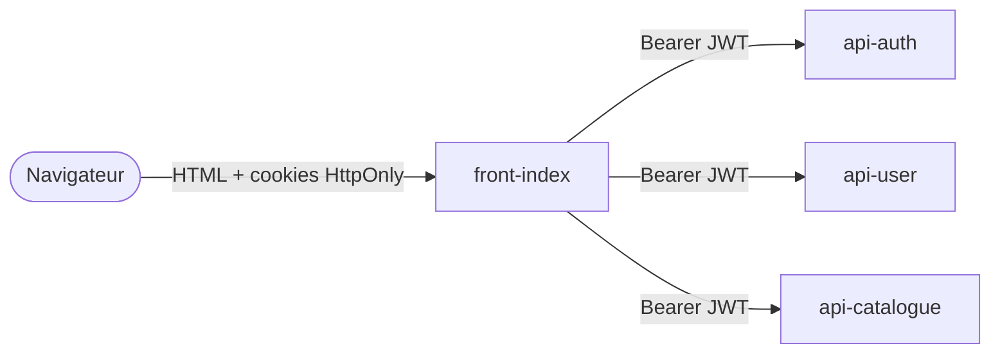

# Vidéothèque · front-end

**Interface web de la vidéothèque : catalogue de films, prêt d'exemplaires entre membres, compte utilisateur et administration. Rendu côté serveur en Flask + Jinja, qui consomme les trois API du [back-end](https://github.com/LOIC-only-one/projet-m705-serveur).**

[](https://github.com/LOIC-only-one/projet-m705-client/actions/workflows/ci-cd.yml)


---

## Rôle dans l'architecture



Le navigateur ne voit jamais les jetons : le front les garde dans des cookies `HttpOnly` + `SameSite=Strict`, les envoie aux API en `Authorization: Bearer` et renouvelle l'accès automatiquement avec le refresh token quand il expire.

## Pages

| Page | Contenu |
|---|---|
| `/` | Accueil |
| `/catalogue` | Films disponibles (importés depuis TMDB) |
| `/films/<id>` | Fiche d'un film : exemplaires, emprunt, ajout de son propre exemplaire |
| `/videotheque` | Mes exemplaires et mes emprunts : prolongation, retour |
| `/account` | Profil, changement de mot de passe, suppression du compte |
| `/admin` | Gestion des utilisateurs (rôle admin) |
| `/login`, `/register` | Connexion et inscription |

## Configuration

| Variable | Défaut |
|---|---|
| `API_AUTH_URL` | `http://api-auth:8000` |
| `API_USER_URL` | `http://api-user:8000` |
| `API_CATALOG_URL` | `http://api-catalogue:8000` |

## Lancer

Le front se lance avec le reste de la pile depuis le dépôt serveur (voir [projet-m705-serveur](https://github.com/LOIC-only-one/projet-m705-serveur#lancer-en-local)) :

```bash
git clone https://github.com/LOIC-only-one/projet-m705-serveur.git
git clone https://github.com/LOIC-only-one/projet-m705-client.git
cd projet-m705-serveur && ./secrets/generer.sh && docker compose -f compose.test.yml up -d --build
```

Chaque push sur `main` construit l'image `ghcr.io/loic-only-one/videotheque-front-index`, déployée ensuite sur Docker Swarm avec le reste de la pile.

---

Projet réalisé à deux : [Loïc Maurer](https://github.com/LOIC-only-one) et [NTQQQQ](https://github.com/NTQQQQ).
